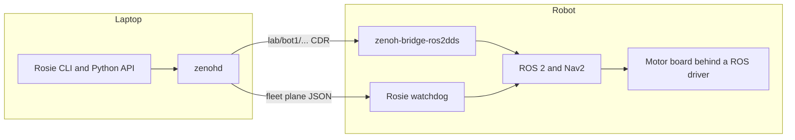

# Architecture

Rosie is the laptop side of a ROS 2 fleet. The robot keeps its ROS graph. Zenoh is the only thing that crosses the network.

## Two planes

**Robot data** is CDR, the ROS 2 serialization, on keys the bridge derives from a ROS name. A bridge namespace `/lab/bot1` and a topic `/cmd_vel` become the Zenoh key `lab/bot1/cmd_vel`. Actions use the same prefix plus `/_action/send_goal`, `cancel_goal`, `get_result`, `feedback`, and `status`. The laptop encodes and decodes with the types in the robot's profile. The payload is unchanged ROS, so a ROS node on the far side can deserialize it.

**Fleet plane** is a small set of JSON keys Rosie owns, because ROS has no equivalent: presence, estop, the router announcement, and leader claims. They live under `{fleet}/_fleet/...` except presence, which is `{fleet}/{robot}/presence`. The watchdog publishes presence on its own Zenoh session, not through the bridge, so a bridge crash does not look like the robot left, and estop still has a path.

## What runs where

| Piece | Where | Needs ROS? |
|---|---|---|
| `rosie` CLI, `Session`, `Fleet`, `MobileRobot`, viz, bags | Laptop | No |
| `zenohd` (`rosie router`) | Laptop, or one machine the fleet can reach | No |
| `zenoh-bridge-ros2dds` | Robot | Talks to the robot's DDS |
| `rosie robot watchdog` | Robot | Yes (`rclpy` from the robot's ROS install) |

The watchdog is the only Rosie code that imports `rclpy`. Install it in a venv created with `--system-site-packages` so it sees the distro's ROS libraries. The laptop venv stays ROS-free. That extra is `rosie-framework[robot]`; it adds no pip packages.

## Sessions

A `Session` is a Zenoh client bound to one fleet and one robot. Relative keys get a `{fleet}/{robot}/` prefix, which is the same string the bridge namespace produces. `publish_ros` / `subscribe_ros` take a ROS type name. `query` does not add a prefix: action clients pass the full bridge key.

`mode` is `client` by default (connect to `rosie router`). `peer` and `router` listen as well, for a robot that should keep working when the fleet router is absent. The bridge config from `rosie robot setup` has the same three modes.

## Versions

The router and the bridge are pinned to Zenoh 1.9.0. They are not wire-compatible with `rmw_zenoh`. A robot that uses `rmw_zenoh` instead of the bridge is a different key layout, described in [Add a robot](robots/adding-a-robot.md). Supported ROS distros for the bridge path are Humble, Jazzy, and Lyrical. The bridge's topic keys do not change between those distros. `rmw_zenoh` type hashes do.
