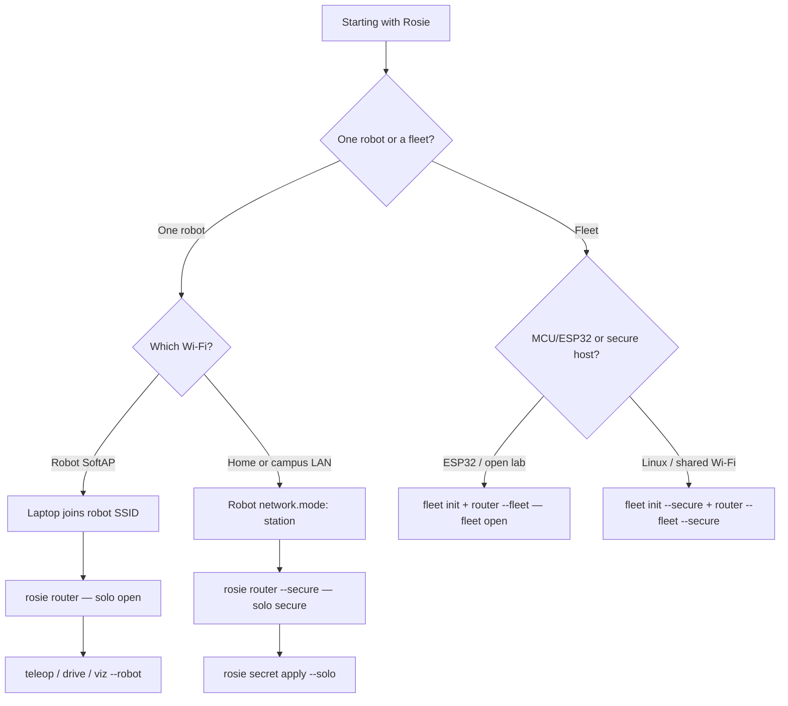

# Fleet management

Operator guide for **solo vs fleet** bring-up and membership. Security layers,
threat model, and the four open/secure modes:
[Security](security.md). Wi‑Fi topology:
[Fleet networking](fleet-networking.md).

## Choose your setup



| Path | Router | Secret? | Allowlist? |
|------|--------|---------|------------|
| **Solo SoftAP** | `rosie router` | No | N/A |
| **Solo shared Wi‑Fi** | `rosie router --secure` | Yes (`~/.rosie/solo/secret`) | N/A |
| **Fleet open** (ESP32) | `rosie router --fleet X` | No | No |
| **Fleet secure** | `rosie router --fleet X --secure` | Yes | Yes on `fleet list` / `topics` with `--secure` |

`--fleet` alone does **not** enable auth. Leftover secret files do not silently
secure an open router. Details: [Security](security.md).

## Solo SoftAP

Default desk demo. Robot hosts Wi‑Fi; laptop joins; `rosie router` stays **open**.

```bash
rosie router
rosie teleop --robot car1
```

## Solo on shared Wi‑Fi

SoftAP isolation is gone. Opt in to bus auth:

```bash
rosie router --secure                 # ~/.rosie/solo/secret
cd mybot && rosie secret apply --solo # writes network.fleet_secret into robot.yaml
rosie mcu build && rosie mcu flash
rosie teleop --robot car1
```

## Fleet open (multi-robot ESP32)

Create the fleet home, enroll ids, start an **open** bus:

```bash
rosie fleet init --fleet demofleet
rosie fleet add --fleet demofleet --robot car1
# set fleet: demofleet in each robot.yaml (no fleet_secret needed)
rosie mcu build && rosie mcu flash
rosie router --fleet demofleet
rosie fleet list --fleet demofleet
```

- Creating `robot.yaml` does **not** enroll a robot — run `fleet add`.
- `fleet init` does **not** start the router; `router --fleet` does **not** create the fleet.
- Open mode shows all presence under the fleet prefix (no allowlist filter).

## Fleet secure (host / Linux)

```bash
rosie fleet init --fleet lab --secure   # manifest + secret
rosie fleet add --fleet lab --robot bot1
rosie secret apply --fleet lab          # into robot.yaml / agent.yaml
rosie router --fleet lab --secure
rosie fleet wait --fleet lab --secure
rosie fleet list --fleet lab --secure   # allowlist on
```

Existing open fleets: add a secret later with `rosie fleet secret --fleet lab --set`,
then pass `--secure` on router and fleet tools.

### Second person joining (secure)

1. Operator: `rosie fleet add --fleet lab --robot theirbot` and share the secret
   (`rosie fleet secret --fleet lab`).
2. Collaborator: `rosie fleet secret --fleet lab --set`, set `fleet: lab`,
   `rosie secret apply`, then build/flash.

The secret is **not** sent over Zenoh. Rotate with
`rosie fleet secret --fleet lab --rotate`, then re-share and rebuild every robot.

`--manifest path` overrides when the roster lives in a course repo (ids only —
never commit the secret).

## Related docs

- [Security](security.md) — four modes, layered model, ESP32 limits
- [Fleet networking](fleet-networking.md) — dedicated AP vs SoftAP topology
- [Conventions](conventions.md) — `(fleet, robot)` identity and presence
- [BYOR](byor.md) — standing up a native robot
- [Getting started](getting-started.md) — install and first router
