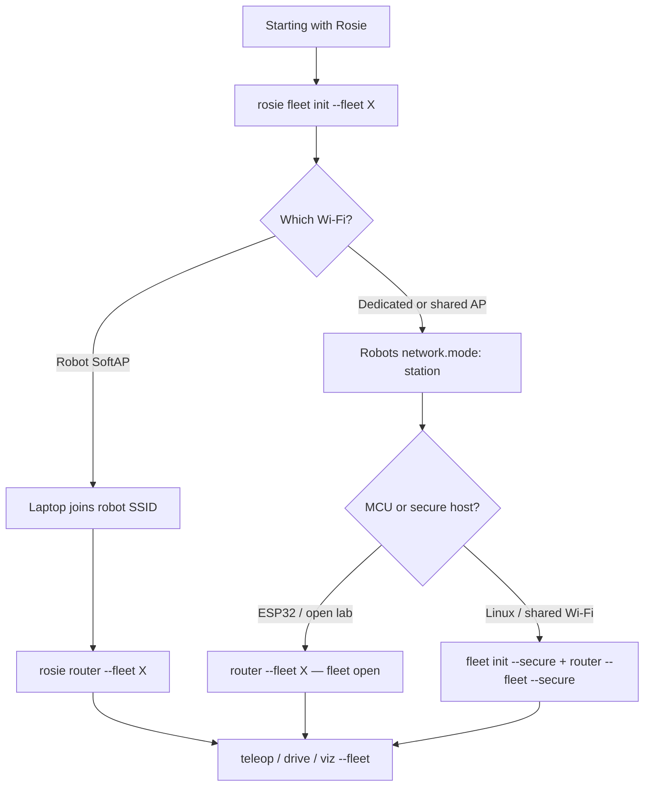

# Fleet management

Operator guide for fleet bring-up and membership. A **fleet is required** for
every robot on the bus (including a single desk MCU). Security layers,
threat model, and the two open/secure modes:
[Security](security.md). Wi‑Fi topology:
[Fleet networking](networking.md).

## Choose your setup



| Path | Router | Secret? | Allowlist? |
|------|--------|---------|------------|
| **Fleet open** (ESP32 / SoftAP) | `rosie router --fleet X` | No | No |
| **Fleet secure** | `rosie router --fleet X --secure` | Yes | Yes on `fleet list` / `topics` with `--secure` |

`--fleet` alone does **not** enable auth. Leftover secret files do not silently
secure an open router. Details: [Security](security.md).

Create the fleet **before** starting the router. `fleet init` writes
`~/.rosie/fleets/<id>/manifest.yaml`. `router --fleet` does **not** create
that home; it exits if the manifest is missing.

## Fleet open (MCU / SoftAP / travel AP)

```bash
rosie fleet init --fleet demofleet
rosie fleet add --fleet demofleet --robot car1
# set fleet: demofleet in each robot.yaml (no fleet_secret needed)
rosie mcu build && rosie mcu flash
rosie router --fleet demofleet
rosie fleet list --fleet demofleet
```

- Creating `robot.yaml` does **not** enroll a robot — run `fleet add`.
- `fleet init` does **not** start the router; `router --fleet` does **not** create the fleet.
- Open mode shows all presence under the fleet prefix (no allowlist filter).
- SoftAP is a **Wi-Fi** choice for one MCU (laptop joins the robot SSID). The
  robot still publishes `{fleet}/{robot}/…`.

## Fleet secure (host / Linux)

```bash
rosie fleet init --fleet lab --secure   # manifest + secret
rosie fleet add --fleet lab --robot bot1
rosie secret apply --fleet lab          # into robot.yaml / agent.yaml
rosie router --fleet lab --secure
rosie fleet wait --fleet lab --secure
rosie fleet list --fleet lab --secure   # allowlist on
```

Existing open fleets: add a secret later with `rosie fleet secret --fleet lab --set`,
then pass `--secure` on router and fleet tools.

### Second person joining (secure)

1. **Operator** enrolls their robot id and shares the bus secret out-of-band
   (chat, USB stick — not over Zenoh):

   ```bash
   rosie fleet add --fleet lab --robot theirbot
   rosie fleet secret --fleet lab          # prints the secret to copy
   ```

2. **Collaborator** stores that secret on their laptop (prompted, or pass it
   after `--set`), points the robot yaml at the fleet id, then copies the
   secret into the robot config and builds:

   ```bash
   rosie fleet secret --fleet lab --set              # prompts: Fleet secret:
   # or: rosie fleet secret --fleet lab --set '<paste-secret>'
   ```

   In `robot.yaml` / `agent.yaml`, set the fleet **id** (not the secret):

   ```yaml
   fleet: lab
   ```

   ```bash
   rosie secret apply --fleet lab          # writes network.fleet_secret into yaml
   # then build/flash (MCU) or restart `rosie run` / `rosie agent`
   ```

The secret is **not** sent over Zenoh. Rotate with
`rosie fleet secret --fleet lab --rotate`, then re-share and rebuild every robot.

`--manifest path` overrides when the roster lives in an experiment repo (ids
only — never commit the secret).

## Related docs

- [Fleet (Python)](../host/fleet.md) — `Fleet` kwargs / methods (wait, topics, estop)
- [Security](security.md) — two modes, layered model, ESP32 limits
- [Fleet networking](networking.md) — SoftAP vs dedicated AP topology
- [Conventions](../conventions.md) — `(fleet, robot)` identity and presence
- [BYOR](../robots/byor.md) — standing up a native robot
- [Getting started](../getting-started.md) — install, fleet init, first router
