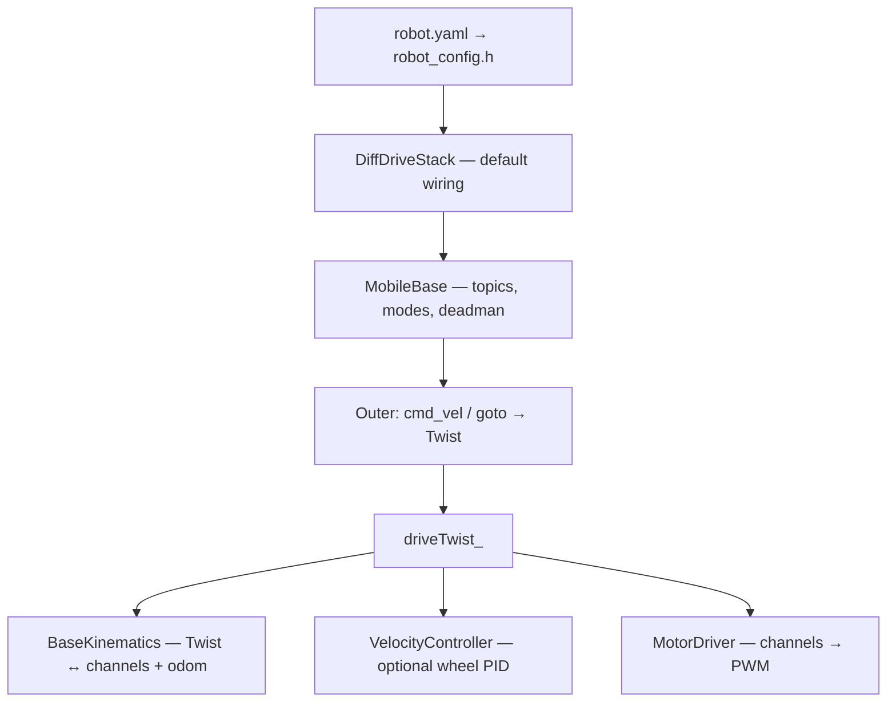

# Mobile base

Opt-in firmware + host layer for **planar ground robots** (differential drive in
v1). Transport remains `rosie::Session` / Python `Session`; `MobileBase` /
`DiffDriveStack` add drivers, kinematics, deadman, goto, and standard topics.

## What you write

1. **`robot.yaml`** — identity, network, pins, geometry, gains.
2. **Thin `main.cpp`** using **`DiffDriveStack`** (recommended), or raw
   `MobileBase` for custom wiring.
3. Optional custom `cmd` ops via `stack.base().onCmd(...)`.

Scaffold a new project:

```bash
mkdir mybot && cd mybot
rosie mcu init --robot mybot
# edit robot.yaml pins / SSID
rosie mcu setup && rosie mcu flash
rosie drive --config robot.yaml
```

## Recommended firmware (`DiffDriveStack`)

Include the generated header, then the stack:

```cpp
#include <Arduino.h>
#include "generated/robot_config.h"
#include <rosie/diff_drive_stack.h>

static rosie::DiffDriveStack g_stack;

void setup() {
  Serial.begin(115200);
  delay(300);
  // Optional: g_stack.base().onCmd("my_op", handler);
  g_stack.begin();
}

void loop() {
  g_stack.loop();
}
```

`rosie mcu build` / `gen-config` regenerates `robot_config.h` from `robot.yaml`.
`DiffDriveStack` wires TB6612, encoders, DiffDrive kinematics, optional IMU/camera,
Wi‑Fi, Zenoh, SerialShell, MobileBase, and a `PidVelocityController` (default
gains `0,0,0` = open-loop feedforward).

Accessors: `stack.base()`, `stack.motors()`, `stack.encoders()`, `stack.imu()`,
`stack.camera()`, `stack.velocityController()`.

## Cascaded control

Both teleop (`cmd_vel`) and goto share one actuation path:

1. **Outer loop** — host Twist, or onboard goto (pose error → Twist in m/s, rad/s).
2. **Inner loop** — `driveTwist_`: kinematics feedforward channels + optional
   per-wheel velocity PID → `MotorDriver`.

```yaml
control:
  goto:                    # outer: pose → Twist
    kp_linear: 0.8
    kp_angular: 1.5
    v_max: 0.35
    w_max: 1.5
  velocity:                # inner: omit or kp=ki=kd=0 for open-loop
    type: pid
    kp: 0.0
    ki: 0.0
    kd: 0.0
    i_clamp: 0.5
```

Default velocity gains are **zero** (same feel as open-loop). Non-zero
starter gains are robot-specific — tune with `rosie tune`.

### Live tuning

```bash
rosie tune --config robot.yaml          # interactive
rosie tune set --config robot.yaml --kp 0.3
rosie tune save --config robot.yaml     # persist live gains into YAML
rosie mcu flash                         # bake saved defaults
```

Cmd ops: `set_gains` `{kp,ki,kd,i_clamp}` (partial OK), `get_gains`. Telemetry on
`control` (gains + target/meas wheel velocities).

Custom inner loop: implement `VelocityController` and
`base.setVelocityController(&ctrl)` (or inject via BYO MobileBase).

## Escape hatch: raw `MobileBase`

If you need a non-TB6612 driver or custom sensor wiring, construct
`MotorDriver` / kinematics yourself and pass them into `MobileBase`. Optionally
attach a `VelocityController`. Keep using relative topics so `rosie teleop` /
`rosie drive` still work.

## Layers

Think of it as a stack: you write config + a thin sketch; Rosie fills in the
middle; hardware sits at the bottom.



- **`robot.yaml` → `robot_config.h`** — pins, gains, network, feature flags (what you edit)
- **`DiffDriveStack`** — default glue: constructs the pieces below from that config
  - **`MobileBase`** — topics, IDLE/MANUAL/AUTO, deadman, goto
    - **Outer loop** — host `cmd_vel` or onboard goto → body Twist `(v, w)`
    - **`driveTwist_`** (shared by teleop and goto)
      - **`BaseKinematics`** — Twist ↔ feedforward channels + wheel velocities + odometry
      - **`VelocityController`** — optional closed-loop correction on wheel velocity (default: PID with gains `0,0,0` = open-loop)
      - **`MotorDriver`** — channels in `[-1, 1]` → PWM

Steering variants (mecanum / ackermann later) plug in as new kinematics;
`MobileBase` stays shared. Other velocity algorithms implement `VelocityController`
and select via `control.velocity.type` (v1: `pid` only).

## `robot.yaml`

See the reference car’s `robot.yaml`. Required: `robot`, `network`, `base`,
`motors`. Optional: `encoders`, `imu`, `camera`, `control`.

Inventory: [Drivers](drivers.md) / `rosie drivers list`.

## Standard topics (MobileBase)

| Topic | Direction | Notes |
|-------|-----------|-------|
| `cmd_vel` | host → robot | `Twist` `{v,w}` |
| `goto` | host → robot | `{x,y}` meters |
| `cmd` | host → robot | `stop`, `zero`, `set_gains`, `get_gains`, plus custom ops |
| `pose` | robot → host | `x,y,theta` plus `mode`, `navigating`, `dist`, optional IMU flags |
| `control` | robot → host | velocity gains + target/meas wheel vel (when controller attached) |
| `presence` | robot → host | heartbeat |
| `log` | robot → host | status lines |
| `camera/compressed` | robot → host | JPEG bytes (if camera in YAML) |

## Host

With the robot on the bus and `rosie router` running:

```bash
rosie drive --config robot.yaml
rosie teleop --robot mybot
rosie tune --config robot.yaml
```

Drive REPL includes optional camera `snap` / `cam` when the robot publishes
JPEG. For the OpenCV viewer on the host: `pip install "rosie[camera]"` (robots
can publish `camera/compressed` without that extra).

### `rosie drive`

Interactive REPL over `rosie.Robot` for a MobileBase / DiffDriveStack robot.
Uses `robot.yaml` for identity (or `--robot` / `ROSIE_ROBOT`). Optional:
`--fleet`, `--connect`, `--dir` (search for `robot.yaml`).

```bash
rosie drive --config robot.yaml
# or from a robot project directory:
rosie drive
```

At the `target>` prompt:

| Input | Action |
|-------|--------|
| `x y [x y …]` | Drive a waypoint route (meters in the robot pose frame) |
| `teleop` | Nested WASD teleop (same bindings as `rosie teleop`) |
| `snap` | Capture a camera still (if camera configured) |
| `cam` | Live camera view |
| `zero` | Request pose zero |
| `imu` | Toggle heading source |
| `stop` | Emergency stop |
| `quit` | Exit |

`rosie teleop --robot <id>` is the dedicated WASD → `cmd_vel` tool when you
only want keyboard driving (no waypoint REPL).

### `rosie tune`

Live velocity-PID tuning — see [Live tuning](#live-tuning) above.

### Python (`rosie.Robot`)

Same capabilities from a script or notebook:

```python
from rosie import Robot
with Robot(config_path="robot.yaml") as bot:
    bot.wait_for_pose()
    bot.set_gains(kp=0.3)
    bot.drive_route([(1.0, 0.0), (1.0, 1.0)])
    # bot.teleop()  # optional nested teleop
```

More Session / Robot patterns: [Writing sessions](writing-sessions.md).

## Related

- [BYOR](byor.md) · [Firmware](firmware.md) · [Drivers](drivers.md) · [Conventions](conventions.md) · [Writing sessions](writing-sessions.md)
