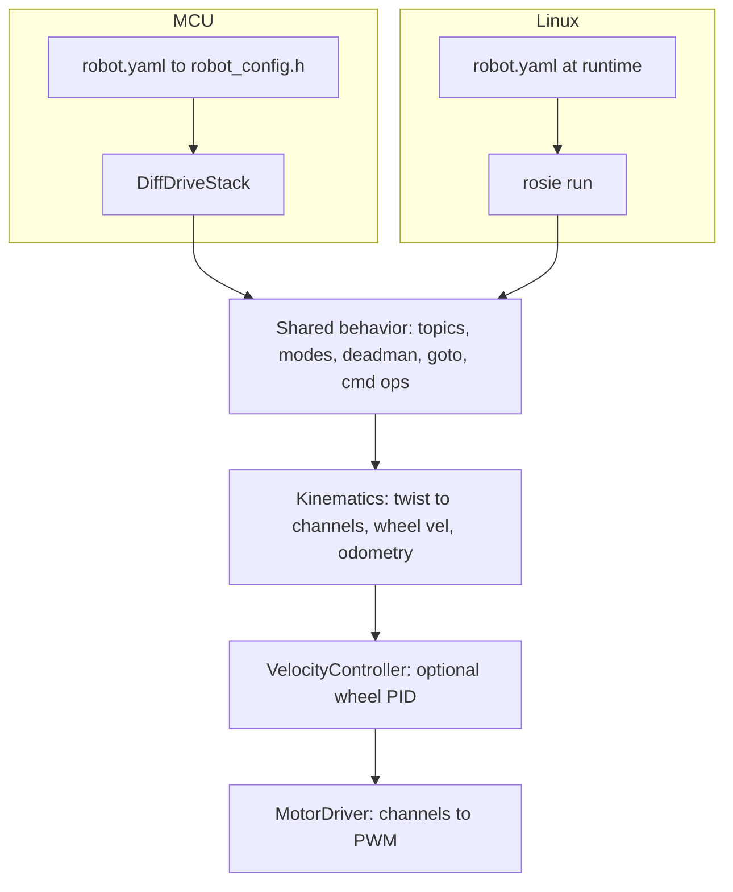
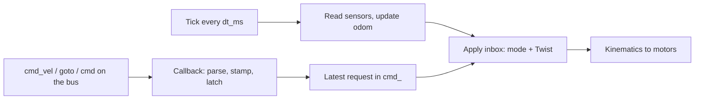

# Mobile base

Shared behavior contract for **planar ground robots** (differential drive in
v1). Transport remains `rosie::Session` / Python `Session`. Platform assembly
differs — MCU uses `DiffDriveStack`, Linux uses `rosie run` — but both honor
the same topics, modes, deadman, goto, and optional velocity PID.

## Layers

Think of it as a stack: you write config; each platform assembles the shared
behavior layer; hardware sits at the bottom.



- **MCU assembly** — `robot.yaml` → `robot_config.h` codegen and
  `DiffDriveStack` wire motors, sensors, `mcuConnect` (Wi‑Fi + Zenoh),
  `MobileBase`, and SerialShell. Details: [Firmware](firmware.md).
- **Linux assembly** — `robot.yaml` (`platform: linux`) read at runtime by
  `rosie run` / `MobileBaseRuntime`. Details: [Linux run](linux-run.md).
- **Shared behavior** — topics, IDLE / MANUAL / AUTO, teleop deadman, goto,
  and `cmd`. Teleop and goto both produce a body Twist `(v, w)` and share one
  actuation path through the layers below.
  - **Kinematics** — steering geometry: Twist ↔ feedforward channels + wheel
    velocities + odometry (DiffDrive today; mecanum / ackermann later).
  - **`VelocityController`** — optional closed-loop correction between
    kinematics outputs and motors. Default PID with gains `0,0,0` ≈ open-loop
    passthrough; if no controller is attached, kinematics channels go straight
    to the motor driver. Select via `control.velocity.type` (v1: `pid` only).
  - **`MotorDriver`** — channels in `[-1, 1]` → PWM. Inventory:
    [Drivers](drivers.md).

### Platform differences

| Concern | MCU | Linux (`rosie run`) |
|---------|-----|---------------------|
| Config apply | codegen + reflash | restart `rosie run` |
| Assembly | `DiffDriveStack` | `MobileBaseRuntime` |
| Camera | yes (`camera/compressed`) | yes (`camera/compressed`) |
| Range (ToF) | yes (`range/<id>`) | yes (`range/<id>`) |
| SerialShell | yes (USB) | no |
| Dead-reckoning without encoders | no (ticks required) | yes |

## Configuring control

Twist sources and the shared actuation path are described in [Layers](#layers).
Configure gains in YAML; tune live on either platform.

### Control loop timing

Two things run at once: an **inbox** (network callbacks) and a **plant loop**
(the control tick). Callbacks write the latest command into a shared slot
(`cmd_`); each tick copies that slot and acts on the copy. A mutex keeps those
two accesses from overlapping. Callbacks never write PWM; the tick never waits
on the network.



**Callbacks (inbox).** When a sample arrives, a subscriber callback runs on the
transport thread (MCU: zenoh-pico **read task**; Linux: Zenoh callback). It
parses JSON, stamps arrival with local time, and stores the latest
`cmd_vel` / `goto` / `stop` / `zero` in `cmd_`. Then it returns. Several
`cmd_vel` messages between ticks overwrite the latch — only the last one is
used. Custom `cmd` handlers that do not move the robot (e.g. `set_gains`) may
run in the callback.

**Tick (plant).** Every `control.dt_ms` (default `20`) the control thread runs
`tick()`: read encoders / IMU, update odometry, snapshot the inbox, arbitrate
mode, then `driveTwist_` → kinematics → optional velocity PID → motors. Goto
is a loop on this period (pose error → Twist), not work the `goto` callback
finishes. Deadman also lives here (age of last `cmd_vel`).

That split is why callbacks exist *and* why they do not drive motors: the
network must deliver commands as soon as they arrive, but the plant needs a
fixed rate, one writer for motors, and one place to order stop vs teleop vs
goto. Driving PWM from the read task would race the tick and jitter with
Wi‑Fi.

**Command precedence:** the tick honors arrival order. A `cmd_vel` older than
the latest `stop` / `zero` does not re-enter MANUAL. While navigating, a `goto`
with the same `goal_id` is ignored (duplicate); a lower id is ignored as stale;
a higher id preempts. Delivery classes for pubs (`nav_result` = COMMAND,
camera = BULK, telemetry = STREAM): [Conventions → Delivery and validity](../conventions.md#delivery-and-validity).

Host `cmd_vel` (MANUAL) or onboard goto (AUTO) produces a body Twist `(v, w)`.
That Twist goes through kinematics, then an optional `VelocityController`,
then the motor driver. Teleop and goto share that path today.

Platform mechanisms (MCU read task + `spin()` vs Python main loop):
[Firmware](firmware.md#control-loop) · [Linux run](linux-run.md#control-loop).

```yaml
control:
  goto:                    # pose → Twist
    kp_linear: 0.8
    kp_angular: 1.5
    v_max: 0.35
    w_max: 1.5
  velocity:                # omit or kp=ki=kd=0 for open-loop
    type: pid
    kp: 0.0
    ki: 0.0
    kd: 0.0
    i_clamp: 0.5
  control_hz: 5            # control topic rate when velocity PID attached
```

Default velocity gains are **zero** (same feel as open-loop). Non-zero
starter gains are robot-specific — tune with `rosie tune`. Requires a
`control.velocity` section (or DiffDriveStack, which always attaches a PID).

### Live tuning

```bash
rosie tune --config robot.yaml          # interactive
rosie tune set --config robot.yaml --kp 0.3
rosie tune save --config robot.yaml     # persist live gains into YAML
# MCU: reflash to bake saved defaults
# Linux: restart `rosie run` to load YAML defaults
```

Cmd ops: `set_gains` `{kp,ki,kd,i_clamp}` (partial OK), `get_gains`. Telemetry on
`control` (gains + target/meas wheel velocities) at `control.control_hz`
(default 5 Hz), plus immediately after gain ops.

## `robot.yaml`

See the reference car’s `robot.yaml`. Required: `robot`, `network`, `base`,
`motors`. Optional: `encoders`, `imu`, `camera`, `range`, `control`.

Inventory: [Drivers](drivers.md) / `rosie drivers list` (`--platform mcu|linux`).

Set `platform: mcu` (default) or `platform: linux`. Shared sections (`robot`,
`fleet`, `network.connect`, `base`, `control`, `range.sensors` layout) port
across platforms; the `motors` / `encoders` / `imu` / `range` pin and bus
blocks are platform-specific (ESP32 GPIO vs Pi BCM / I2C).

Bring-up: [BYOR](byor.md) · MCU: [Firmware](firmware.md) · Linux: [Linux run](linux-run.md).

## Standard topics (MobileBase)

| Topic | Direction | Notes |
|-------|-----------|-------|
| `cmd_vel` | host → robot | `Twist` `{v,w}` |
| `goto` | host → robot | `{x,y,goal_id?}` meters — latest goal wins |
| `nav_result` | robot → host | one-shot `{goal_id,status,x?,y?}` when a goto ends |
| `cmd` | host → robot | `stop`, `zero`, `set_gains`, `get_gains`, `heading_source`, plus custom ops |
| `pose` | robot → host | `x,y,theta` plus `mode`, `navigating`, `dist`, `goal_id` while navigating; `imu_ok` / `imu_heading` when IMU present |
| `control` | robot → host | velocity gains + target/meas wheel vel (when controller attached) |
| `encoders` | robot → host | cumulative ticks (`EncoderTicks`) when `encoders.pub_hz` set |
| `imu` | robot → host | 6-axis `Imu` (`accel_*` m/s², `gyro_*` rad/s) when `imu.pub_hz` set |
| `range/<id>` | robot → host | `Range` (`id`, raw `range`, `range_median`, min/max, `ok`) per sensor in `range.sensors` |
| `presence` | robot → host | heartbeat |
| `log` | robot → host | status lines |
| `camera/compressed` | robot → host | JPEG bytes (if camera in YAML) |

## Motion on the robot

<a id="navigation-helpers"></a>

How the **robot** accepts motion. Host methods and the drive REPL:
[MobileRobot](../host/mobile-robot.md).

| Path | Topics | Who closes the loop |
|------|--------|---------------------|
| MANUAL | `cmd_vel` (`Twist`) | Host streams velocity; robot deadman + tick apply it |
| AUTO | `goto` → `pose` progress → `nav_result` | Robot (one goal at a time) |
| Cancel / origin | `cmd` `stop` / `zero` | Robot; `stop` during AUTO → `nav_result` `canceled` |

Arrival order and `goal_id` rules: [Control loop timing](#control-loop-timing).
Latest `cmd_vel` wins; `stop` / `zero` beat an older `cmd_vel`. While AUTO, a
duplicate `goal_id` is ignored, a lower id is stale, a higher id preempts.
`nav_result` is `succeeded` / `canceled` (`aborted` is reserved — hosts must
tolerate it, robots do not currently emit it).

## Host

Laptop tools once the robot is on the bus (`rosie router` running):

```bash
rosie teleop --robot mybot
rosie drive --config robot.yaml
rosie tune --config robot.yaml
```

Methods, `drive` / `turn` / `drive_to`, and the drive REPL:
[MobileRobot](../host/mobile-robot.md). Camera viewers: [Camera](camera.md)
(`pip install "rosie-framework[camera]"` for OpenCV on the host).

## Related

- [BYOR](byor.md) · [Firmware](firmware.md) · [Linux run](linux-run.md) · [Drivers](drivers.md) · [Camera](camera.md) · [Bridges](bridges.md) · [Conventions](../conventions.md) · [MobileRobot](../host/mobile-robot.md) · [Writing sessions](../host/writing-sessions.md)
