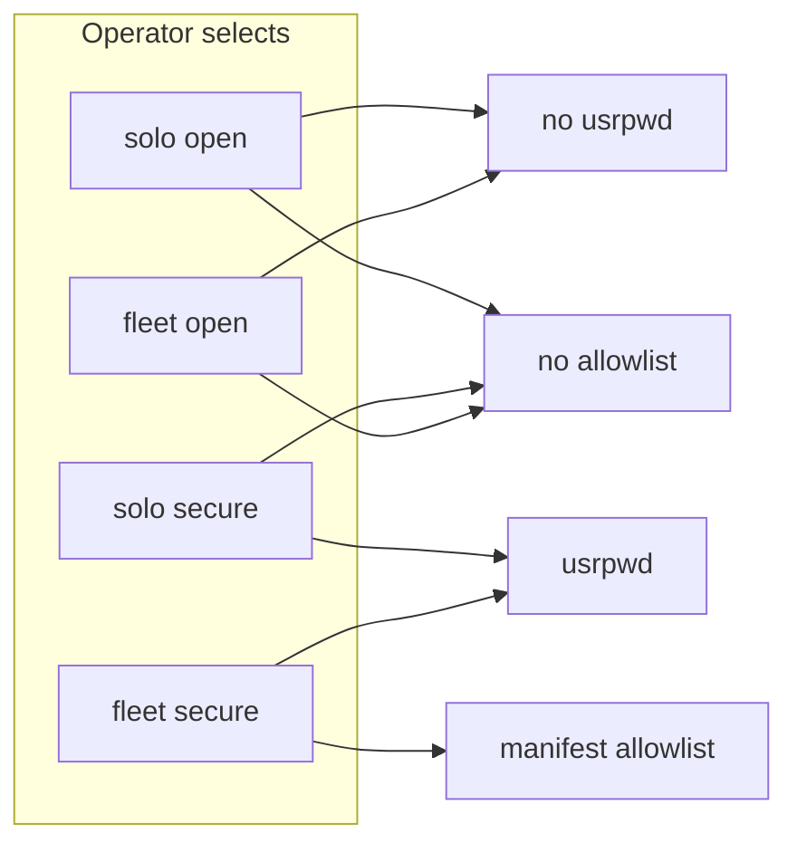

# Security

Layered security model for Rosie buses. Day-to-day fleet commands:
[Fleet management](fleet-management.md). Wi‑Fi topology:
[Fleet networking](fleet-networking.md).

## Threat model

Rosie targets **teaching labs, SoftAP desk demos, and small research fleets** on
a shared LAN or robot SoftAP — not internet-facing robots.

| We assume | We do **not** claim |
|-----------|---------------------|
| Operators control who joins the Wi‑Fi / SoftAP | Hard isolation from a determined LAN attacker |
| Host tools and Linux agents can use Zenoh usrpwd | MCU / zenoh-pico supports usrpwd today |
| Allowlists keep host tooling honest about membership | Stolen enrolled ids cannot publish |

Open mode is intentional for ESP32 SoftAP demos. Secure mode is opt-in via
`--secure` — a leftover secret file must **not** silently enable auth.

## Layers (present + future)

| Layer | Status | What it does |
|-------|--------|--------------|
| **Network isolation** | Present | SoftAP, VLAN, or dedicated travel AP — strangers off the SSID |
| **Bus mode: open vs secure** | Present (host/Linux) | Zenoh usrpwd when `--secure`; open by default |
| **Fleet allowlist** | Present (host tools) | Manifest enrollment filters `fleet list` / `topics` **only in fleet-secure** |
| **App-layer HMAC / signed commands** | Future | MCU-friendly auth without transport usrpwd |
| **Payload encryption / TLS** | Future | Confidentiality beyond shared LAN trust |
| **Per-key Zenoh ACLs** | Future | Stop secret-holders from spoofing another `robot` id |

## Four modes



| Mode | Router | Bus auth | Allowlist on `fleet list` etc. |
|------|--------|----------|--------------------------------|
| Solo open | `rosie router` | No | N/A |
| Solo secure | `rosie router --secure` | Yes (`~/.rosie/solo/secret`) | N/A |
| Fleet open | `rosie router --fleet X` | No | No |
| Fleet secure | `rosie router --fleet X --secure` | Yes | Yes (needs prior `fleet add`) |

**Secure** means: bus auth, and for fleets also host-tool allowlisting.
**Open** (default) has neither. Mode is **CLI-flag driven** — do not rely on
secret file presence alone.

### Commands vs roles

| Command | Role |
|---------|------|
| `rosie fleet init --fleet X` | Create fleet home (`manifest.yaml`; secret only with `--secure`) |
| `rosie fleet add --fleet X …` | Enroll robot ids (allowlist in **secure** mode) |
| `rosie router --fleet X` | Start zenohd for that fleet’s topic scope / secret path |
| `rosie fleet list --fleet X` | Host discovery against the live bus |

`fleet init` does **not** start the router. `router --fleet X` does **not**
create the fleet.

### Fleet open (ESP32 / SoftAP demos)

```bash
rosie fleet init --fleet demofleet
rosie fleet add --fleet demofleet --robot car1
rosie router --fleet demofleet              # open bus (no auth)
rosie fleet list --fleet demofleet          # no allowlist filter
```

### Fleet secure (Linux / host agents)

```bash
rosie fleet init --fleet lab --secure
rosie fleet add --fleet lab --robot bot1
rosie router --fleet lab --secure
rosie fleet list --fleet lab --secure       # allowlist + usrpwd session
```

Write secrets into yaml with `rosie secret apply` (or keep an existing
`network.fleet_secret` and rebuild). Host tools that talk to a secure router
need `--secure` (or an explicit password / `ROSIE_FLEET_SECRET`).

## ESP32 guidance

zenoh-pico does **not** implement Zenoh usrpwd today. MCU fleets should use
**solo open** or **fleet open**. Passing `--secure` on the router will reject
ESP32 clients even when the password hash matches what you baked into firmware.

When you need MCU auth later, prefer an **app-layer** HMAC on commands rather
than waiting for pico transport auth.

## Operator checklist

| Situation | Mode |
|-----------|------|
| One ESP32 SoftAP desk demo | Solo open |
| Several ESP32s on a travel AP / SoftAP lab | Fleet open |
| Linux robots / host agents on shared campus Wi‑Fi | Solo or fleet **secure** |
| Teaching lab where host tools must ignore strangers | Fleet secure (+ enroll with `fleet add`) |

## Related docs

- [Fleet management](fleet-management.md) — init / add / router day-to-day
- [Fleet networking](fleet-networking.md) — SoftAP vs dedicated AP
- [Conventions](conventions.md) — `(fleet, robot)` identity
- [Getting started](getting-started.md)
